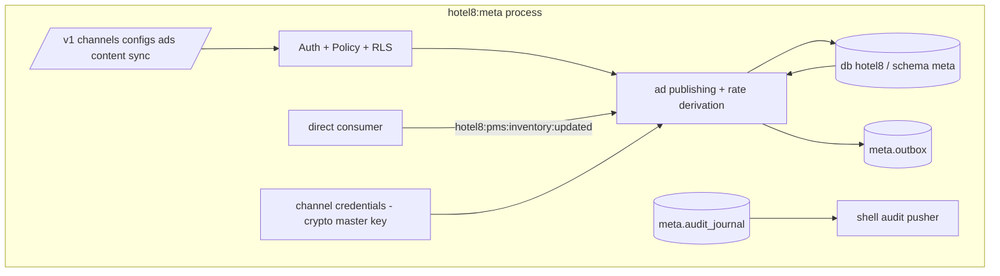

# Hotel8:Meta - Metasearch Integration

## 1. Summary

Hotel8:Meta is the metasearch (Google Hotel Ads, Trivago, Kayak,
TripAdvisor, Skyscanner, TripAdvisor, Bing) integration service for the
hotel8 vertical. It registers metasearch channels, stores their access
credentials encrypted-by-reference, bids/publishes rate advertisements
derived from PMS retail rates, pushes content and rate feeds, tracks clicks
for attribution, and keeps a sync ledger for the full/partial sync flows.

## 2. Motivation

Metasearch is a pay-to-play acquisition surface: rates must be derived from
the live inventory at bid time, content must match the hotel's canonical
facts, and partner credentials are high-value secrets. A dedicated service
keeps credential custody (secret-reference storage, never plaintext), rate
advertisement math separate from revenue management, and click/attribution
telemetry attached to the actual bookings.

## 3. Architecture & High-Level Design

## 4. Key Traits and Data Structures

- **Credential custody** - `meta.channel_secrets` holds secret *references*
  (encrypted material via the platform crypto master key), never plaintext;
  `credentials:stored` events mark the change.
- Ad pricing - `meta.rate_ads` rows carry the derived
  (base ± adjustment) advertisement and their verification state
  (`rate:verified`).
- Sync ledger - `meta.sync_log` records full/partial sync outcomes
  (`full_sync:completed`, `ari:synced`).

## 5. Rationale, Trade-offs, and Alternatives

- **Rate ads derived, never invented** - a published rate is always
  traceable to PMS retail + policy; inventing prices in the ad layer would
  create parity incidents.
- **Secrets by reference** - the channel key is decrypted in-process per
  use; plaintext never reaches tables (platform secret-handling rule).
- **Read-mostly service** - metasearch changes slow; hot path is the
  consumer republish and the booking-attribute telemetry, both event-shaped.

## 6. Internal Implementation & Invariants (Private Design)

- A published ad requires a verified rate state; unverified rates are never
  advertised.
- Every credential change carries the actor through the audit journal.
- Click/attribution rows (`meta.clicks`) are append-only telemetry.
- No `unsafe` code.

## 7. Unresolved Questions / Future Designs

- Bid strategy automation beyond configured adjustments.
- Programmatic content templates.

---

**Design attribution:** hotel8:meta and its underlying concepts were designed by Hamid Jahanzad <Hamid@Jahanzad.com>.
